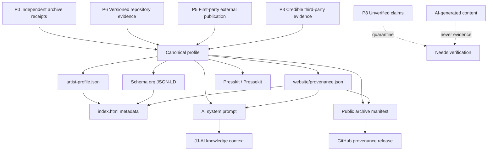

# DJ Jesse Jay Provenance Architecture

## Trust rule

P0–P8 source classes follow `archive/schema.yml` and `website/provenance.json`. Source classification does not by itself verify a claim. Generated content is never evidence.

The graph is directional: generated website/AI copy may consume canonical evidence but may not promote itself back into the evidence layer.
